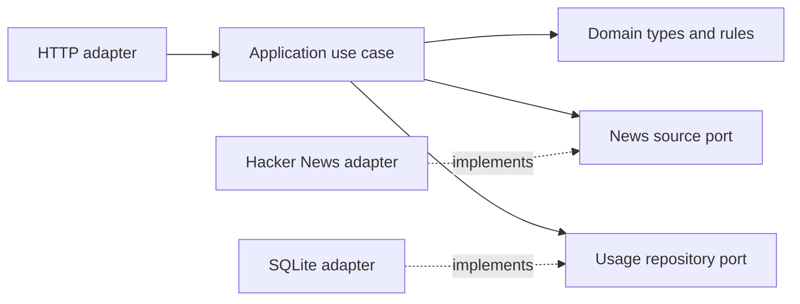

# Architecture

The project uses a small hexagonal structure.

Dependencies point inward. Domain and application do not import Fastify, Cheerio, or SQLite. The outer adapters will implement the application ports.
