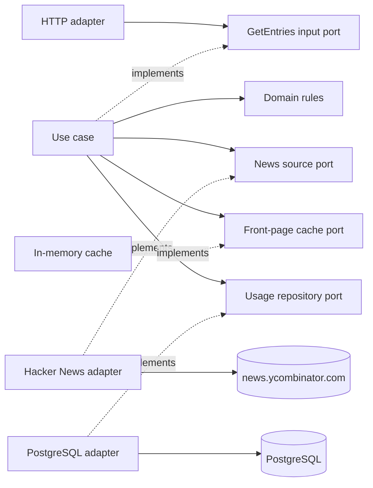

# Architecture

## Key decisions at a glance

1. **Hexagonal architecture.** Business rules and the use case do not know about Fastify, Cheerio, or PostgreSQL. They talk to the outside world only through ports, and `test/architecture.test.ts` fails the build if an inner layer imports an outer one.
2. **Scraping with `fetch` and Cheerio.** The front page already contains every field in its HTML, so a browser (Playwright) is unnecessary, and the exercise asks for scraping rather than the Hacker News API.
3. **A small domain.** It holds only the business rules: an entry, the 30-entry front page, word counting, and the two filters.
4. **One shared, cached front page.** All filters work on the same validated snapshot. It is reused for 60 seconds, and concurrent requests share one download. Responses are fast, and Hacker News receives one download per minute instead of one per request.
5. **Usage history in PostgreSQL.** Requests with a supported filter record their timestamp, applied filter, outcome, result count, cache status, and duration in milliseconds.
6. **Classes for collaborators, functions for transformations.** Dependencies are injected through constructors, and `src/main.ts` is the only place that wires them together.

## Layers

| Layer | Contains | Location |
| --- | --- | --- |
| Domain | `Entry`, `FrontPage` (exactly 30 entries), `countTitleWords`, the `all`/`long`/`short` filters | `src/domain/` |
| Application | `GetEntriesUseCase` and its ports: the input port, the news source, the cache with its `CacheStatus`, and the usage repository with `UsageRecord` | `src/application/` |
| Infrastructure | Adapters for HTTP (Fastify), Hacker News (fetch + Cheerio), the in-memory cache, PostgreSQL, and configuration | `src/infrastructure/` |
| Composition root | Creates the adapters, injects them into the use case, starts the server, and shuts it down on `SIGINT`/`SIGTERM` | `src/main.ts` |

**Why cache statuses and usage records live in the application layer.** They describe how this service runs (whether the cache was hit, whether the crawler failed, how long the request took), not the business rules about Hacker News entries. Each type sits next to the port that uses it: `CacheStatus` with the cache port, `CrawlerOutcome` with `CrawlerError`, and `UsageRecord` with the usage repository port. The domain stays limited to what the exercise defines.

## Classes and functions

Hexagonal architecture fixes the direction of dependencies, not the use of classes. The code follows one rule:

- **Class** when the code implements a port or holds state or dependencies: `GetEntriesUseCase`, `HackerNewsNewsSource`, `InMemoryFrontPageCache`, and `PostgresUsageRepository`. Each receives its collaborators, including clocks, through its constructor, which lets tests replace them.
- **Function** when the code is a pure transformation with nothing to inject: `parseFrontPage`, `filterEntries`, `countTitleWords`, and `mapHttpError`. Tests call them directly with data.

`fetchFrontPage` performs I/O, so it receives `fetch` as a parameter. The parser and the downloader are internal details of the Hacker News adapter; the application only sees `NewsSourcePort`. Adapters own the shape of their settings: the Hacker News adapter declares `HackerNewsOptions`, and the configuration module produces a value of that type.

## Scraping

The parser takes the first 30 `tr.athing` rows and pairs each one with the metadata row that follows it. It checks each entry's id, rank, title, and metadata link, so a broken row fails instead of being replaced silently by row 31. `discuss` counts as zero comments, and job postings count as zero points and comments. A job posting can link to Hacker News or an external site. The parser identifies a job by its spacer image and the absence of voting controls and scoring metadata. The checks are small named functions (`isJobPosting`, `parsePoints`, `parseComments`).

Every failure is a `CrawlerError` with one of three outcomes: `upstream_error` (HTTP or network error), `timeout`, or `invalid_html`. A single deadline covers the request and the response body, because a server can send headers quickly and then stall. When the domain rejects a page that does not have exactly 30 entries, the use case turns that into `invalid_html` too, so the HTTP adapter maps one error type to `502` or `504`.

## Word counting and filters

`countTitleWords` splits on whitespace and counts tokens that contain a Unicode letter or digit, so `This is - a self-explained example` has 5 words: the lone `-` is ignored, and `self-explained` is one word.

Each filter is a strategy: a predicate plus an optional ranking metric. `long` (more than 5 words) sorts by comments and `short` (5 words or fewer) by points, both in descending order, with the original rank breaking ties. The exercise does not specify a direction; descending puts the most active entries first. Adding a filter means adding one entry to the table.

## Cache

The cache stores the validated front page before filtering, so every filter reuses the same download. Concurrent requests that arrive while the cache is empty share one in-flight download. The usage records show this as `miss` for the request that downloaded the page, `coalesced` for the requests that waited for it, and `hit` for later reuse. Failed downloads are never cached, so the next request tries again. Expiry uses a monotonic clock, so a change to the system time cannot extend or shorten the TTL.

## Usage storage

The service records every successful request and every crawler failure. `duration_ms` is measured on a monotonic clock, from the moment the use case starts until its result is ready, which makes the cost of a cache `miss` compared with a `hit` visible in the data. If the record cannot be written, the request returns `500` instead of an unrecorded success.

PostgreSQL survives restarts and is reachable from a hosted deployment, unlike a local SQLite file. The pool is capped at five connections, and an idle-connection error is logged instead of crashing the process.

**Why there is no migration framework.** The service owns one table and runs as one instance. On every start, the repository runs an idempotent script: `CREATE TABLE IF NOT EXISTS`, then `ADD COLUMN IF NOT EXISTS` for columns added later, such as `duration_ms`. This keeps existing databases working with a few lines of SQL. A tool such as node-pg-migrate would become worthwhile with more tables, data migrations, or several instances starting at once. The `CHECK` constraints list their values literally, and a repository test writes every filter, cache status, and outcome that the code defines, so the code and the database cannot drift apart unnoticed.

## Configuration

`loadConfig()` reads the environment once at startup and returns a typed `AppConfig`. Two helpers validate the values: `readInteger` for ports and durations, and `readUrl` for the Hacker News and PostgreSQL URLs. An invalid value stops startup with a `ConfigError` naming the variable, and the message never repeats the value, because a database URL can contain a password. With five variables, plain functions are easier to read than a schema library such as Zod.

`pnpm dev` reads `.env.local` (the local Docker database), and `pnpm start` reads `.env` (production). No development command reads `.env`, so a local run cannot write to the production database by accident.

## Tooling

- **TypeScript on Node.js 24**: built-in `fetch`, and type stripping, so `pnpm dev` runs the source without a separate transpiler.
- **Fastify**: validates the `filter` query parameter with a schema and supports injected requests in tests.
- **Vitest**: unit tests for each layer, HTTP tests without opening a port, and PostgreSQL integration tests. CI runs lint, type checking, tests with coverage, and the build against a PostgreSQL 18 service.
- **Docker Compose**: one command starts PostgreSQL and the API, and `docker compose run --rm test` runs the same suite as CI.
- **pnpm**: the frozen lockfile gives local setup and CI the same dependency versions.
