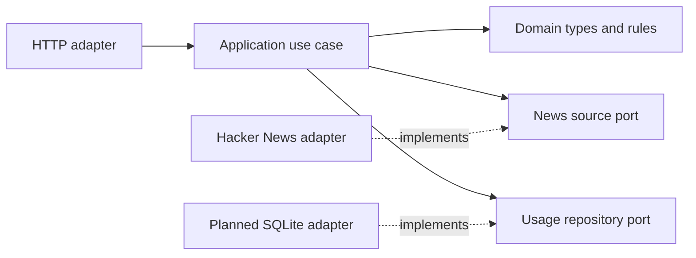

# Architecture

## Why a hexagonal structure

The crawler has two external dependencies with different reasons to change. Hacker News can change its HTML, and the application can change how it stores usage records. Ports give the use case a stable contract for each dependency. This lets us test the use case with an in-memory source and keep page selectors and SQL inside their respective adapters.

The diagram shows how the adapters will connect to the application.

Dependencies point inward. The domain defines the entry shape, the allowed filter values, and the front-page size rule. The application requests entries through the news source port and validates the result. Fastify is the inbound adapter. The Hacker News infrastructure downloads HTML and parses it into entries. The server will connect both operations to the news source port, and the planned SQLite adapter will store usage records.

The source tree groups business concepts under `src/domain/`, use cases and their contracts under `src/application/`, and concrete adapters under `src/infrastructure/`. The ports live in `src/application/ports/` because the use case defines the capabilities it needs. The HTTP adapter, Hacker News downloader, and environment configuration each have a folder in infrastructure. The SQLite folder will be added with its implementation.

## Why Node.js and TypeScript

Node.js provides `fetch` for downloading the HTML. TypeScript gives the parser, use case, and ports a shared definition of an entry. Strict type checking helps catch missing fields and incorrect assumptions about optional values. The parser and HTTP adapter still validate external input at runtime.

## Why Fastify

Fastify provides query validation through a schema and lets tests exercise the route with an injected request. The adapter can validate the filter at the HTTP boundary and delegate the work to the use case.

## Why pnpm

The project declares the pnpm version in `package.json` and commits `pnpm-lock.yaml`. Local setup and CI use a frozen lockfile so both install the recorded dependency graph. CI caches the pnpm store to reuse downloaded packages between runs.

## Why Vitest and CI

Vitest lets us test the use case with a fake source, simulate failed downloads, and exercise the Fastify route without opening a port. The test directories mirror `src/`. The parser tests use saved HTML and run independently of the live site. CI runs lint, type checking, tests with coverage, and the build so reviewers can see whether a change meets the same checks used locally.

## Why SQLite for usage records

The usage history should survive a restart and be easy to inspect. SQLite provides persistent, queryable storage in a local file without requiring a database service. When usage tracking is added, its repository port will keep storage details out of the use case.

## Why Cheerio for Hacker News

The titles, scores, and comment counts are already present in the HTML returned by the Hacker News front page. Node's `fetch` downloads that response, and the parser uses Cheerio selectors to pair each story with its metadata row. The parser can also run against saved HTML in tests, which makes the results repeatable without a network request.

We considered three alternatives:

- **Playwright** runs a browser and can read content that appears after JavaScript executes or after user interaction. We would reconsider it if Hacker News moved the required fields to client-side rendering. The current page already provides them in the response.
- **jsdom** provides browser-style APIs such as `window` and `document`. The scraper only needs to select elements, traverse the HTML, and read text, which Cheerio provides directly.
- **The Hacker News API** would provide structured data, but the exercise specifically asks us to extract it by scraping the front page.

The parser selects the first 30 ranked rows before validating them. It rejects malformed entries within that group to preserve their original positions. It treats `discuss` as zero comments and assigns zero points and comments to entries with the job listing markup.

Cheerio belongs inside the Hacker News adapter. The application receives typed entries through the news source port, so a change to the parser or page markup stays inside that adapter.

## Why load configuration at startup

`loadConfig()` reads and validates the environment in one place. The future server entry point will call it once and pass the resulting settings to the downloader. The downloader accepts those settings directly, which lets its tests run without changing the process environment.

## Why one download deadline

The adapter uses one abort signal for both the request and the response body. A server can send headers promptly and then stall while sending HTML, so a deadline that ends when the headers arrive would leave the crawler waiting. The adapter reports timeouts separately from HTTP and network errors. Each download makes one request, with redirects rejected, so the time and request count stay predictable.

## Why map errors at the HTTP boundary

The news source port defines errors in terms of the operation that failed. Fastify translates those errors into HTTP status codes and gives every route the same response format. Clients receive a stable code and a public message, while the server log keeps details such as the original cause.

## Why the domain validates the front page size

`FrontPage.create()` accepts exactly 30 entries. The use case requests that count and validates the collection it receives, so a source that returns fewer or more entries cannot produce a successful response. This rule applies before filtering, since each filtered list can legitimately contain fewer entries.
