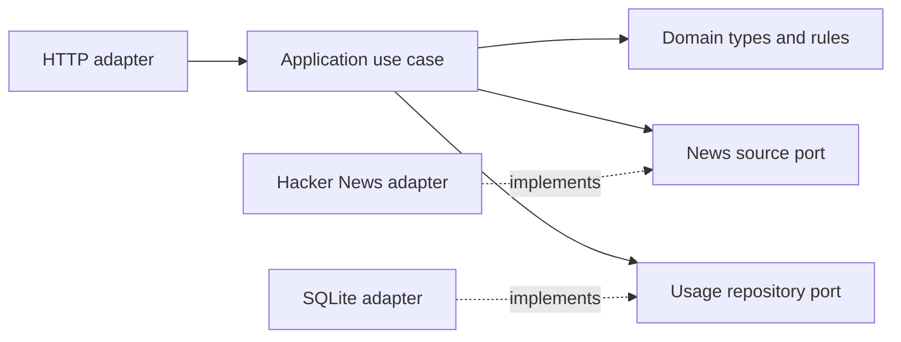

# Architecture

The project uses a small hexagonal structure.

Dependencies point inward. Domain and application do not import Fastify, Cheerio, or SQLite. The outer adapters will implement the application ports.

## Why Cheerio for Hacker News

The titles, scores, and comment counts are already present in the HTML returned by the Hacker News front page. Node's `fetch` downloads that response, and Cheerio parses it so the adapter can use CSS selectors to read each story and its metadata. The parser can also run against saved HTML in tests, which makes the results repeatable without a network request.

We considered three alternatives:

- **Playwright** runs a browser and can read content that appears after JavaScript executes or after user interaction. We would reconsider it if Hacker News moved the required fields to client-side rendering. The current page already provides them in the response.
- **jsdom** provides browser-style APIs such as `window` and `document`. The scraper only needs to select elements, traverse the HTML, and read text, which Cheerio provides directly.
- **The Hacker News API** would provide structured data, but the exercise specifically asks us to extract it by scraping the front page.

Cheerio belongs inside the Hacker News adapter. The application receives typed entries through the news source port, so a change to the parser or page markup stays inside that adapter.
