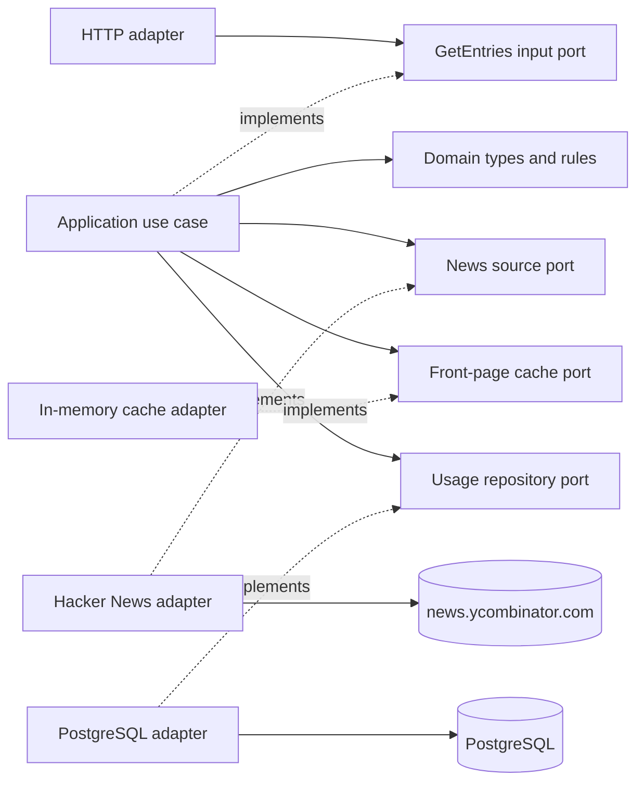
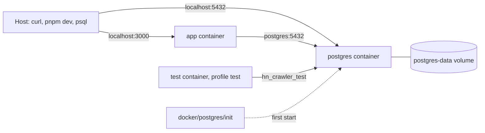

# Architecture

## Why a hexagonal structure

The crawler has external dependencies with different reasons to change. Hacker News can change its HTML, and the application can change how it stores usage records. Ports give the use case a stable contract for each dependency. This lets us test the use case with in-memory implementations and keep page selectors and SQL inside their respective adapters.

The diagram shows how the adapters connect to the application and to the external systems.

Dependencies point inward. The application defines the ports it needs; concrete adapters implement them in infrastructure. Fastify depends only on the `GetEntriesPort` input port, so route tests can pass a stub instead of the real use case. `test/architecture.test.ts` walks every file in `src/domain/` and `src/application/` and fails if one imports an external package or a module from an outer layer. The responsibilities and the main code locations are:

| Area | Responsibility | Main files |
| --- | --- | --- |
| Domain | Entry and usage-record rules, the 30-entry invariant, title word counting, filter strategies, cache statuses, and crawler outcomes | `src/domain/` (`entry.ts`, `front-page.ts`, `title.ts`, `filter.ts`, `usage-record.ts`, `cache-status.ts`, `crawler-outcome.ts`) |
| Application | Implement the `GetEntriesPort` input port: fetch a snapshot through outbound ports, validate it, apply filters, and record outcomes | `src/application/get-entries.use-case.ts` |
| Ports | Input port (`get-entries.port.ts`); outbound ports for the news source, front-page cache (with `FrontPageLoadError`), and usage repository; the shared `CrawlerError` | `src/application/ports/` |
| HTTP adapter | Validate query parameters, call the `GetEntriesPort` input port, map errors, and return cache metadata | `src/infrastructure/http/` |
| Hacker News adapter | Download and parse the front page using `fetch` and Cheerio | `src/infrastructure/hacker-news/` |
| Cache adapter | Reuse snapshots for the TTL and coalesce concurrent downloads | `src/infrastructure/cache/` |
| PostgreSQL adapter | Persist usage records through a connection pool, apply versioned migrations, and survive dropped connections | `src/infrastructure/database/` |
| Configuration | Read and validate environment variables once at startup | `src/infrastructure/config/` |
| Composition root | Wire adapters and the use case, start Fastify, and shut down on signals | `src/main.ts` |
| Local runtime | Build images and run PostgreSQL, the API, and the containerized test suite | `Dockerfile`, `docker-compose.yaml`, `docker/postgres/init/` |

`src/main.ts` is the composition root: it loads configuration, connects to PostgreSQL and applies migrations, constructs the remaining adapters and use case, builds the Fastify application, and starts listening. It closes the connection pool when Fastify shuts down, and it calls `app.close()` on `SIGINT`, `SIGTERM`, or a failed `listen`. Keeping this wiring outside the adapters makes dependencies visible and lets route tests inject a fake use case without opening a socket.

## Documentation map

The [README](../README.md) is the setup and usage guide: the Docker quick start, host development, the configuration reference, and the PostgreSQL inspection query. [Testing and local verification](testing.md) contains the automated and manual database, Docker, and cache checks, plus troubleshooting. [Benchmark methodology and live results](benchmark-results.md) records the performance run. [`AGENTS.md`](../AGENTS.md) gives coding agents concise repository instructions; it points back to these user-facing guides rather than duplicating their explanations.

## Why Node.js and TypeScript

Node.js provides `fetch` for downloading the HTML. TypeScript gives the parser, use case, and ports a shared definition of an entry. Strict type checking helps catch missing fields and incorrect assumptions about optional values. The parser and HTTP adapter still validate external input at runtime.

## Why Fastify

Fastify provides query validation through a schema and lets tests exercise the route with an injected request. The adapter can validate the filter at the HTTP boundary and delegate the work to the use case.

## Why pnpm

The project declares the pnpm version in `package.json` and commits `pnpm-lock.yaml`. Local setup and CI use a frozen lockfile so both install the recorded dependency graph. CI caches the pnpm store to reuse downloaded packages between runs.

## Why Vitest and CI

Vitest lets us test the use case with a fake source, simulate failed downloads, and exercise the Fastify route without opening a port. The test directories mirror `src/`. The parser tests use saved HTML and run independently of the live site. CI runs lint, type checking, tests with coverage, and the build so reviewers can see whether a change meets the same checks used locally. The workflow starts a PostgreSQL 18 service and sets `TEST_DATABASE_URL`, so the repository integration tests always run there; locally, `docker compose run --rm --build test` gives the same setup. The actions use their Node 24 releases (`checkout@v7`, `setup-node@v7`, `pnpm/action-setup@v6`).

## Why PostgreSQL for usage records

The API needs storage that persists across web-service restarts and is reachable from the deployed application. Managed PostgreSQL provides that boundary without tying the application to Render's local filesystem. The `UsageRepositoryPort` keeps the choice inside infrastructure, while the `PostgresUsageRepository` uses `pg`'s asynchronous connection pool. Pool size is capped at five connections to leave headroom on the small free database plan; connection attempts have a finite timeout so a database outage does not hang startup indefinitely.

`DATABASE_URL` is the only connection setting. It is supplied as an environment secret and never committed. Render provides an internal URL for services in the same region; use that URL for the deployed API. Local development uses the Docker Compose database (see below); a provider's external URL also works but requires TLS. Place the web service in the database's region to use Render's private network and avoid public database traffic. The free database is intended for prototyping and has a limited lifetime, so a longer-lived deployment should use a database plan with an appropriate retention period.

Each request that completes successfully or fails with a recognized crawler error records an ISO 8601 UTC timestamp, the normalized filter, outcome, result count, snapshot timestamp when available, and cache status. Recognized crawler failures include timeouts, upstream errors, and invalid front pages. Failed downloads have no snapshot timestamp, a result count of zero, and do not populate the cache. A later request retries the source. A storage error propagates to the HTTP boundary and returns `500` rather than returning an unrecorded success.

The repository tracks schema versions in `schema_migrations` and applies pending migrations sequentially inside a transaction protected by a PostgreSQL advisory lock. The lock prevents concurrent application starts from applying the same migration at once. The migration ledger and usage-table changes commit together. Migration 1 creates `usage_records` with every current field and its `CHECK` constraints, plus an index on `requested_at`. If migration or connection initialization fails, the repository closes its pool before rethrowing the initialization error. Future schema changes must add a new numbered migration rather than editing one that has already been applied.

`pg` emits an `error` event when an idle pooled connection drops, for example when PostgreSQL restarts. Node exits on an unhandled `error` event, so the repository always registers a listener that logs the failure; the pool discards the broken connection and opens a new one for the next query.

## Why Docker Compose for local development

The service now needs a PostgreSQL server, so a local run depends on more than Node.js. `docker-compose.yaml` starts PostgreSQL 18 (the same major version CI uses) and the API with one command, and the API waits for the database health check before it applies migrations. An init script creates a separate `hn_crawler_test` database, so the repository integration tests run locally against the same engine as in CI instead of being skipped.

The `Dockerfile` is multi-stage. The `test` stage contains the full source tree and runs `pnpm test:coverage`; the `runtime` stage contains only the compiled JavaScript and production dependencies and runs as the unprivileged `node` user. pnpm comes from Corepack, so the image uses the version pinned in `package.json`, and the Node version matches `.node-version`. The runtime image reads its configuration from the environment, which matches how a hosting provider supplies `DATABASE_URL`. Node runs as the container's main process and handles `SIGTERM` itself, so `docker compose stop` closes Fastify and the connection pool and exits with code 0. The Compose credentials are fixed and local-only; deployed environments supply their own secret URL.

The usage history lives in the named `postgres-data` volume, so `docker compose down` keeps it and only `docker compose down -v` deletes it. The init script runs only when that volume is empty. `APP_PORT` and `POSTGRES_PORT` change the published ports without editing the Compose file.

## Why Cheerio for Hacker News

The titles, scores, and comment counts are already present in the HTML returned by the Hacker News front page. Node's `fetch` downloads that response, and the parser uses Cheerio selectors to pair each story with its metadata row. The parser can also run against saved HTML in tests, which makes the results repeatable without a network request.

We considered three alternatives:

- **Playwright** runs a browser and can read content that appears after JavaScript executes or after user interaction. We would reconsider it if Hacker News moved the required fields to client-side rendering. The current page already provides them in the response.
- **jsdom** provides browser-style APIs such as `window` and `document`. The scraper only needs to select elements, traverse the HTML, and read text, which Cheerio provides directly.
- **The Hacker News API** would provide structured data, but the exercise specifically asks us to extract it by scraping the front page.

The parser selects the first `limit` ranked rows (30 by default) before validating them. The news source port documents that `limit` must be a positive integer, and the adapter honors any such value, so it can substitute for the port without hidden restrictions; the domain still requires 30 for a front-page snapshot. It rejects malformed entries within that group to preserve their original positions. It treats `discuss` as zero comments and assigns zero points and comments to entries with the job listing markup.

Cheerio belongs inside the Hacker News adapter. The application receives typed entries through the news source port, so a change to the parser or page markup stays inside that adapter.

## Why load configuration at startup

`loadConfig()` reads and validates the environment in one place. The server entry point calls it once and passes the resulting settings to the downloader, the repository, and the listener, so application code does not read `process.env` from multiple modules. `HN_URL`, `FETCH_TIMEOUT_MS`, and `DATABASE_URL` are required; `PORT` defaults to `3000` and `CACHE_TTL_MS` to `60000`. `DATABASE_URL` must be a `postgres://` or `postgresql://` URL with a host and database name. The downloader accepts settings directly, which lets its tests run without changing the process environment.

The rules are declarative. `app-config.ts` holds one schema table that maps each variable to a reusable rule from `env-schema.ts`: `integer({ min, max, fallback })` for ports and durations, and `url({ protocols, requirePath })` for the Hacker News and PostgreSQL URLs. Limits such as the highest port and Node's maximum timer delay are named constants, and a rule with no `fallback` is required. `readEnv` applies the whole table and throws a single `ConfigError` that lists every invalid variable, so a broken deployment shows all its problems at once. Rule messages never repeat the rejected value, because a database URL can contain a password. Adding a variable means adding one schema row, not another parsing function.

We considered a schema library such as Zod. With five variables and two kinds of rule, the in-house rules are about forty lines that the project tests directly, and they avoid another runtime dependency. The rest of the application depends only on the `AppConfig` interface, so moving to a library later, if the configuration grows or needs complex transformations, would only change these two files.

## Why separate local and production environment files

Node's `--env-file` option loads the values before the application starts. `pnpm dev` and `pnpm benchmark` read `.env.local`, which points at the local Docker database; `pnpm start` reads `.env`, which points at production. Each file has its own committed template (`.env.local.example` and `.env.example`), and both real files are ignored by Git. Because no development command reads `.env`, a development run cannot write to the production database by accident. Containers do not use either file: Compose and the hosting provider set the variables directly.

## Why use Node's TypeScript support in development

`pnpm dev` runs `src/main.ts` with Node's built-in TypeScript type stripping and watch mode, using `.env.local`. This avoids a separate development transpiler in a small Node 24 project. `pnpm start` runs the JavaScript emitted by the TypeScript build, keeping development execution separate from the production-style path.

## Why one download deadline

The adapter uses one abort signal for both the request and the response body. A server can send headers promptly and then stall while sending HTML, so a deadline that ends when the headers arrive would leave the crawler waiting. The adapter reports timeouts separately from HTTP and network errors. Each download makes one request, with redirects rejected, so the time and request count stay predictable.

## Why map errors at the HTTP boundary

The news source port defines errors in terms of the operation that failed. Fastify translates those errors into HTTP status codes and gives every route the same response format. Clients receive a stable code and a public message, while the server log keeps details such as the original cause.

## Why the domain validates the front page size

`FrontPage.create()` accepts exactly 30 entries. The use case requests that count and validates the collection it receives, so a source that returns fewer or more entries cannot produce a successful response. This rule applies before filtering, since each filtered list can legitimately contain fewer entries.

## Why title word counting is a domain function

`countTitleWords()` is a pure domain rule, so it does not depend on the crawler, HTTP framework, or storage. It splits on whitespace and counts only tokens containing a Unicode letter or number. This keeps hyphenated text within one spaced word and ignores standalone punctuation and emoji, matching the exercise's example.

## Why filtering runs after the front-page validation

The use case first verifies that the source returned exactly 30 entries, then applies the requested domain filter. The `long` and `short` predicates are complementary (`> 5` and `<= 5`), so every source entry belongs to exactly one group. Long titles sort by comments and short titles by points, both descending, with the original rank as a deterministic tie-breaker. The `all` filter preserves the source order. Each filter is a strategy in one table (a predicate plus an optional ranking metric), so adding a filter adds a table entry without changing the sorting code.

## Why the front-page cache is shared in memory

All filters operate on the same first 30 entries, so the cache stores the validated front-page snapshot before filtering. A successful load is reused for the configured TTL (60 seconds by default). Concurrent requests arriving during an empty or expired cache share one in-flight promise; their records distinguish the loader (`miss`), concurrent waiters (`coalesced`), and later reuse (`hit`). When the shared load fails, the cache rejects every caller with a `FrontPageLoadError` that carries that caller's status and keeps the crawler error as its `cause`. The use case records the failure with the correct status and rethrows the original error, so HTTP error mapping does not change. The cache uses a monotonic clock for expiration and a wall-clock ISO timestamp for the snapshot. The endpoint returns that shared timestamp in `X-Front-Page-Fetched-At` while keeping the JSON body as the entry array. `CACHE_TTL_MS` can tune the TTL without changing code.
